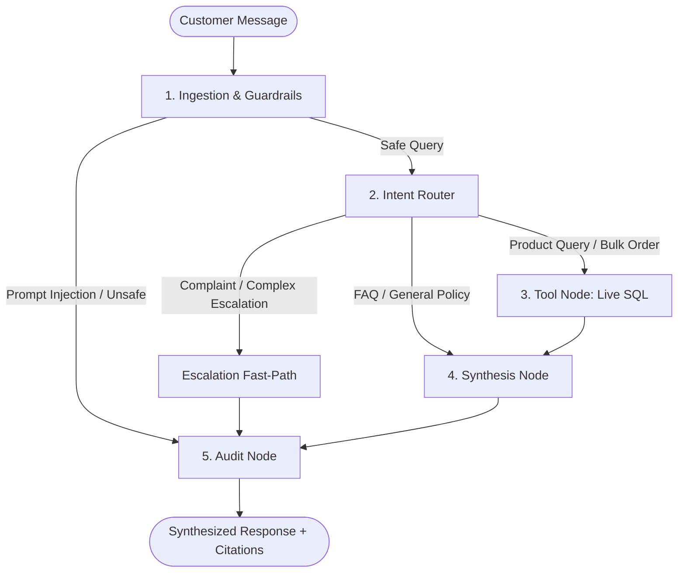

# SalesOS / CRM B2BTrader

> **Enterprise B2B CRM & Inventory-Grounded Conversational AI Platform**  
> *Deterministic Inventory Verification &bull; Strict Zero-Tolerance Price Grounding &bull; LangGraph Stateful Reasoning &bull; DeepEval Automated Benchmarks*

---

## 📌 Overview

**CRM B2BTrader (SalesOS)** is an enterprise-grade B2B Customer Relationship Management (CRM) and Conversational AI platform tailored for industrial distribution, wholesale parts trading, and supply chain enterprises.

Unlike generic LLM wrappers that fabricate prices or guess stock levels, SalesOS operates on an **inventory-grounded StateGraph architecture**:
- **Zero-Tolerance Hallucination**: AI sales agents can only quote verified stock quantities and catalogue prices directly retrieved via read-only SQL queries from the live database.
- **Multiturn State Machine**: Built on **LangGraph**, the agent validates inbound queries against guardrails, classifies commercial intents, runs parameterised tool lookups, and synthesises professional quotation responses.
- **Prompt Versioning Studio**: In-browser prompt governance allowing engineering and sales operations teams to iterate, diff, test, and rollback system prompts across all graph nodes.
- **Automated DeepEval Suite**: Continuous evaluation of agent turns across Faithfulness, Relevancy, Hallucination, and Tool Correctness against curated Golden Datasets.
- **Omnichannel Support**: Handles incoming inquiries through embedded Web Chat, live Instagram Direct Messages (via Meta Graph API webhooks), and WhatsApp.

---

## 🏛️ System Architecture

```
                                  ┌─────────────────────────────────────────┐
                                  │           React / Vite Client           │
                                  │  (Pragmatic Modernism Design System)    │
                                  └────┬───────────────────────────────┬────┘
                                       │ REST / JWT                    │ REST / SSE
                                       ▼                               ▼
                      ┌───────────────────────────────┐ ┌────────────────────────────────┐
                      │    Django CRM REST Backend    │ │    AI Agent Service (FastAPI)  │
                      │          (Port 8000)          │ │          (Port 8001)           │
                      └──────────────┬────────────────┘ └──────────────┬─────────────────┘
                                     │                                 │
                                     │                                 │ LangGraph State Machine:
                                     │                                 │ 1. Guardrail Ingestion
                                     │                                 │ 2. Router Node (Intent/SKU)
                                     │                                 │ 3. Tool Node (Read-only SQL)
                                     │                                 │ 4. Synthesis Node (LLM Grounding)
                                     │                                 │ 5. Audit & Cost Telemetry
                                     ▼                                 ▼
                      ┌───────────────────────────────┐ ┌────────────────────────────────┐
                      │     Live CRM Database         │ │      Observability Store       │
                      │  (Customers, Products, Orders)│ │ (Audit Logs, Prompts, Eval Runs)│
                      └───────────────────────────────┘ └────────────────────────────────┘
```

### LangGraph Agent Topology



---

## 🚀 Key Features

### 1. B2B Industrial CRM Core
- **Customer 360 View**: Full customer dossier with purchase cadence, RFM segmentation (Champions, Loyal, At-Risk, Hibernating), GST compliance, and omnichannel interaction timelines.
- **Live Inventory Ledger**: Real-time stock counts, dead-stock flags, reorder alerts, landed cost protection, and automated alternative-part recommendations.
- **Order Management & Receivables**: Order status pipeline (Pending, Confirmed, Shipped, Delivered) with aged invoice tracking (30/60/90+ day aging buckets).
- **Role-Based Access Control (RBAC)**: Secure multi-tenant roles for **Owners** (full governance, user management, margins, prompt versioning) and **Sales Reps** (scoped customer pipeline).

### 2. Inventory-Grounded Conversational AI
- **Strict Grounding Rules**: Never reveals internal landed costs or grants unapproved discounts. Quoting is locked to exact catalogue figures.
- **Multiturn Memory**: Carries conversation context across multiple messages while defending against jailbreaks, system prompt extractions, and injection attacks.
- **Full Provenance & Citations**: Every claim is annotated with the source database table, record ID, and execution timestamp in the audit drawer.

### 3. Prompt Versioning Studio (`/admin/agent-prompts`)
- Visual version control for all agent system prompts:
  - `router_node`: Intent classification and SKU extraction rules.
  - `synthesis_node`: Quotation synthesis and grounding constraints.
  - `faq_node`: General shipping, warranty, and company policy rules.
  - `guardrail_node`: Prompt injection defense and safety refusals.
  - `escalation_node`: Human supervisor handoff messaging.
- **One-Click Rollbacks**: Seamlessly toggle between prompt iterations with live activation.
- **Baseline Seeder**: Instant initialization of standard production templates.

### 4. DeepEval Benchmark & Golden Dataset Suite (`/admin/agent-eval`)
- **Golden Dataset Management**: CRUD interface for defining reference customer queries, expected intents, target entities, and ground-truth answers.
- **Automated Metric Suite**:
  - `Faithfulness`: Verifies claims strictly match retrieved DB fields.
  - `Answer Relevancy`: Verifies the customer's intent is directly answered.
  - `Hallucination`: Zero tolerance for ungrounded monetary figures or invent stock claims.
  - `Tool Correctness`: Verifies the correct tools and search terms were executed.
- **Run Versioning**: Tracks benchmark scores across releases (`eval_v1`, `eval_v2`, etc.) with drift tracking and latency diagnostics.

### 5. Token & Cost Observability
- Fine-grained token metrics: Input Tokens, Output Tokens, and Thinking / Reasoning Tokens.
- Runtime Pricing Engine: Custom cost calculation per 1M tokens with model override modal.

---

## 🛠️ Tech Stack

| Layer | Technologies |
|---|---|
| **Frontend** | React 18, Vite, Tailwind CSS v3, React Router v6, Lucide Icons, React-Markdown, Remark-GFM |
| **CRM Backend** | Python 3.10+, Django 5.2, Django REST Framework, Django Filter, SQLite / PostgreSQL |
| **AI Agent Service** | FastAPI, LangGraph, LangChain Core / OpenAI, SQLAlchemy, OpenRouter |
| **Evaluation** | DeepEval, Custom LLM-Judge & Grounding Heuristics |
| **DevOps & Containers**| Docker, Docker Compose, Nginx, Gunicorn, Uvicorn |

---

## 📦 Directory Structure

```
CRM_B2Btrader/
├── agent_service/               # FastAPI LangGraph AI microservice
│   ├── api/                     # Webhook handlers (Instagram Graph API, etc.)
│   ├── config/                  # Pydantic runtime settings
│   ├── db/                      # SQLAlchemy models, schema registry, seed defaults
│   ├── eval/                    # DeepEval runner and metric checks
│   ├── graph/                   # LangGraph nodes, guardrails, state machine
│   ├── tests/                   # 35+ scenario and node unit tests
│   ├── app.py                   # FastAPI application & REST endpoints
│   └── requirements.txt         # Agent service Python dependencies
├── crm/                         # Django CRM application
│   ├── auth_views.py            # RBAC login & user administration
│   ├── models.py                # Customers, Products, Orders, Invoices, Interactions
│   ├── views.py                 # REST API viewsets & serializers
│   └── analytics_views.py       # RFM segmentation & pipeline analytics
├── crm_backend/                 # Django project configuration (settings, urls, wsgi)
├── frontend/                    # Vite + React frontend application
│   ├── src/                     # Pages, components, API clients, design system
│   ├── Dockerfile               # Multi-stage production Nginx container
│   └── package.json             # NPM dependencies
├── tests/                       # Project-wide modular test suite (pytest)
│   ├── test_auth.py             # Auth & user serializer tests
│   ├── test_crm_models.py       # CRM database models & schema integrity
│   ├── test_agent_prompts.py    # Prompt versioning & seeder tests
│   └── test_agent_eval.py       # DeepEval metrics & golden dataset tests
├── docker-compose.yml           # Multi-container orchestration (CRM, Agent, Web)
├── Dockerfile.django            # Production Django backend container
├── Dockerfile.agent             # Production FastAPI Agent container
├── requirements.txt             # Django backend Python dependencies
├── pytest.ini                   # Project test runner configuration
└── README.md                    # Project documentation
```

---

## ⚡ Quick Start

### Option 1: Docker Compose (Recommended)

1. **Clone the repository:**
   ```bash
   git clone https://github.com/your-username/CRM_B2Btrader.git
   cd CRM_B2Btrader
   ```

2. **Configure environment variables:**
   ```bash
   cp .env.example .env
   ```
   Add your `OPENROUTER_API_KEY` in `.env`.

3. **Build and start all services:**
   ```bash
   docker-compose up --build
   ```

4. **Access the application:**
   - **Frontend UI**: [http://localhost:3000](http://localhost:3000)
   - **CRM REST API**: [http://localhost:8000/api/v1/](http://localhost:8000/api/v1/)
   - **Agent API Docs**: [http://localhost:8001/docs](http://localhost:8001/docs)

---

### Option 2: Local Development Setup

#### 1. Backend Setup (Django)
```bash
# Create and activate virtual environment
python -m venv .venv
source .venv/bin/activate  # On Windows: .venv\Scripts\activate

# Install dependencies
pip install -r requirements.txt
pip install -r agent_service/requirements.txt

# Run migrations and seed initial CRM users
python manage.py migrate
python seed_users.py

# Start Django development server
python manage.py runserver 0.0.0.0:8000
```

#### 2. AI Agent Service Setup (FastAPI)
```bash
# In a new terminal (with virtual environment active):
uvicorn agent_service.app:app --host 0.0.0.0 --port 8100 --reload
```

#### 3. Frontend Setup (Vite / React)
```bash
# In a new terminal:
cd frontend
npm install
npm run dev
```
Open [http://localhost:5173](http://localhost:5173) in your browser.

---

## 🔐 Default Credentials

When running with initial seeds:

| Role | Username | Password | Access Level |
|---|---|---|---|
| **Owner** | `owner` | `owner123` | Full Access (CRM, Prompts, Eval, Users) |
| **Sales Rep** | `amit.sales` | `sales123` | CRM Customers, Orders, Chat Widget |
| **Sales Rep** | `priya.sales` | `sales123` | CRM Customers, Orders, Chat Widget |

---

## 🧪 Testing & Verification

Run the full project test suite with `pytest`:

```bash
# Run modular tests in tests/
pytest tests/ -v

# Run agent state machine scenario tests
pytest agent_service/tests/test_scenarios.py -v

# Run all test suites
pytest
```

Verify frontend build integrity:
```bash
cd frontend
npm run build
```

---

## 📄 License

Distributed under the MIT License. See `LICENSE` for more information.
