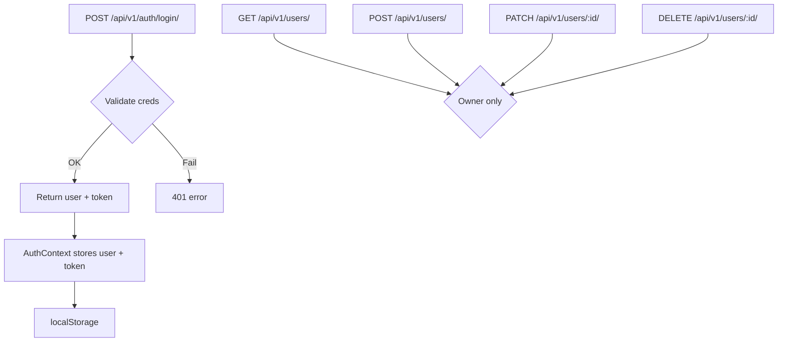

# SalesOS Auth & RBAC Upgrade — Implementation Plan

## Goal
Replace the current one-click demo role selector on `/login` with a full **credential-based authentication system** and **Role-Based Access Control (RBAC)** across the Django REST backend (`crm/`) and React/Vite frontend (`frontend/src/`). Add a **Team Management UI** exclusively for the Owner role.

---

## Research Findings

### Current state
| Area | What exists |
|------|-------------|
| `crm/models.py` | No user/staff model. Only `Customer`, `Product`, `Order`, `Invoice`, `Interaction`, `SystemConfiguration`. |
| `AuthContext.jsx` | Pure mock — `MOCK_USERS` dict, `login(role)` sets static user object. No API calls. No `localStorage`. |
| `Login.jsx` | Two static buttons: "Continue as Admin" / "Continue as Sales Rep". No form. |
| `DashboardLayout.jsx` | Reads `user.name` and `user.role` from context, but doesn't gate routes. |
| `crm_backend/settings.py` | No seed config, no `AUTH_USER_MODEL` override. |
| Migrations | `0001_initial.py` + `0002_*` — no `CRMUser` table. |

### Architecture decision: Simple Token Auth (no Django REST Framework JWT package needed)
Since we want zero new package dependencies (Django is already available), I will use **Django's built-in `django.contrib.auth`** for password hashing and generate **random token strings** stored in a `AuthToken` table. No `djangorestframework-simplejwt` dependency. This keeps the backend lean.

> [!IMPORTANT]
> **Alternative**: If you prefer JWT (stateless), we can add `djangorestframework-simplejwt`. This plan uses simple DB tokens for now — tell me if you want JWT instead.

---

## User Review Required

> [!IMPORTANT]
> **Session persistence strategy**: The plan stores the auth token in `localStorage` on the frontend. Since the existing CRM has no HTTPS in dev, this is acceptable for a demo/internal tool. For production, you'd use `httpOnly` cookies.

> [!WARNING]
> **Migration creates a new table `crm_crmuser`** and a token table. This is **non-destructive** — no existing data is touched. The `db.sqlite3` will get two new tables after running `python manage.py migrate`.

> [!IMPORTANT]
> **`is_active` guard**: The seed command creates users with `is_active=True`. Deactivated users cannot log in. The plan enforces this server-side on the login endpoint.

---

## Proposed Changes

### Component diagram



---

### Backend — `crm/`

---

#### [MODIFY] `crm/models.py`
Add `CRMUser` and `AuthToken` models at the **bottom** of the file (non-destructive):

```python
ROLE_CHOICES = [
    ('Owner', 'Owner'),
    ('Sales', 'Sales'),
    ('Accounts', 'Accounts'),
]

class CRMUser(models.Model):
    id = models.UUIDField(primary_key=True, default=uuid.uuid4, editable=False)
    name = models.CharField(max_length=255)
    username = models.CharField(max_length=150, unique=True)
    email = models.EmailField(blank=True, null=True)
    password_hash = models.CharField(max_length=255)
    role = models.CharField(max_length=20, choices=ROLE_CHOICES, default='Sales')
    is_active = models.BooleanField(default=True)
    created_at = models.DateTimeField(auto_now_add=True)

    def set_password(self, raw_password):
        from django.contrib.auth.hashers import make_password
        self.password_hash = make_password(raw_password)

    def check_password(self, raw_password):
        from django.contrib.auth.hashers import check_password
        return check_password(raw_password, self.password_hash)

    def __str__(self):
        return f"{self.username} ({self.role})"

class AuthToken(models.Model):
    user = models.ForeignKey(CRMUser, on_delete=models.CASCADE, related_name='tokens')
    token = models.CharField(max_length=64, unique=True, db_index=True)
    created_at = models.DateTimeField(auto_now_add=True)
```

---

#### [NEW] `crm/migrations/0003_crmuser_authtoken.py`
Django migration creating `crm_crmuser` and `crm_authtoken` tables. Generated via `makemigrations`.

---

#### [NEW] `crm/management/commands/seed_users.py`
Management command that reads from `settings.py` and idempotently creates/updates the three seed users:

```python
class Command(BaseCommand):
    def handle(self, *args, **kwargs):
        seeds = getattr(settings, 'CRM_SEED_USERS', [])
        for u in seeds:
            obj, created = CRMUser.objects.get_or_create(username=u['username'])
            obj.name = u['name']
            obj.role = u['role']
            obj.is_active = True
            obj.set_password(u['password'])
            obj.save()
```

The command is called automatically from `AppConfig.ready()` in a `CrmConfig` class.

> [!IMPORTANT]
> **Auto-seed on startup**: I will use Django's `AppConfig.ready()` signal to run the seed. This fires on every server start and is idempotent. No manual step needed.

---

#### [MODIFY] `crm_backend/settings.py`
Add seed user config (reads from `.env` with fallbacks):

```python
import os

CRM_SEED_USERS = [
    {
        'username': os.getenv('CRM_OWNER_USERNAME', 'owner'),
        'password': os.getenv('CRM_OWNER_PASSWORD', 'owner123'),
        'name':     os.getenv('CRM_OWNER_NAME', 'Rahul Sharma'),
        'role':     'Owner',
    },
    {
        'username': os.getenv('CRM_SALES1_USERNAME', 'amit.sales'),
        'password': os.getenv('CRM_SALES1_PASSWORD', 'sales123'),
        'name':     os.getenv('CRM_SALES1_NAME', 'Amit Verma'),
        'role':     'Sales',
    },
    {
        'username': os.getenv('CRM_SALES2_USERNAME', 'priya.sales'),
        'password': os.getenv('CRM_SALES2_PASSWORD', 'sales123'),
        'name':     os.getenv('CRM_SALES2_NAME', 'Priya Nair'),
        'role':     'Sales',
    },
]
```

---

#### [NEW] `crm/auth_views.py`
Dedicated auth + user management views:

```
POST /api/v1/auth/login/
  - Body: { username, password, login_type: "Owner"|"Team" }
  - Validates: credentials, is_active, role vs login_type
  - Returns: { user: {id, name, username, email, role}, token: "<64-char hex>" }

GET  /api/v1/users/        — List users (Owner only, checked via token)
POST /api/v1/users/        — Create user (Owner only)
PATCH /api/v1/users/<id>/  — Reset password / toggle active (Owner only)
DELETE /api/v1/users/<id>/ — Delete user (Owner only, cannot delete self)
```

**Auth middleware helper** (inline function, not Django middleware):
```python
def get_authenticated_owner(request):
    token_str = request.headers.get('Authorization', '').removeprefix('Bearer ').strip()
    token = AuthToken.objects.select_related('user').filter(token=token_str).first()
    if not token or not token.user.is_active or token.user.role != 'Owner':
        return None
    return token.user
```

---

#### [NEW] `crm/user_serializers.py`
```python
class CRMUserSerializer(serializers.ModelSerializer):
    class Meta:
        model = CRMUser
        fields = ['id', 'name', 'username', 'email', 'role', 'is_active', 'created_at']

class CreateUserSerializer(serializers.Serializer):
    name = serializers.CharField()
    username = serializers.CharField()
    email = serializers.EmailField(required=False, allow_blank=True)
    password = serializers.CharField(write_only=True)
    role = serializers.ChoiceField(choices=['Sales', 'Accounts'])

class PatchUserSerializer(serializers.Serializer):
    password = serializers.CharField(required=False)
    is_active = serializers.BooleanField(required=False)
```

---

#### [MODIFY] `crm_backend/urls.py`
Add new auth routes:
```python
from crm.auth_views import login_view, users_view, user_detail_view

urlpatterns += [
    path('api/v1/auth/login/', login_view),
    path('api/v1/users/', users_view),
    path('api/v1/users/<str:user_id>/', user_detail_view),
]
```

---

#### [NEW] `crm/apps.py`
```python
class CrmConfig(AppConfig):
    name = 'crm'
    def ready(self):
        from .management.commands.seed_users import seed_default_users
        try:
            seed_default_users()
        except Exception:
            pass  # DB may not be ready yet during migrations
```

---

### Frontend — `frontend/src/`

---

#### [MODIFY] `src/api/customerService.js`
Add `authClient` (same base URL, adds `Authorization` header from `localStorage`):

```js
// Add to existing file
export const authClient = axios.create({ baseURL: BASE, timeout: 10_000 });
authClient.interceptors.request.use(cfg => {
  const token = localStorage.getItem('crm_auth_token');
  if (token) cfg.headers.Authorization = `Bearer ${token}`;
  return cfg;
});

export const loginApi = (username, password, loginType) =>
  authClient.post('auth/login/', { username, password, login_type: loginType });

export const fetchUsersApi = () => authClient.get('users/');
export const createUserApi = (data) => authClient.post('users/', data);
export const patchUserApi = (id, data) => authClient.patch(`users/${id}/`, data);
export const deleteUserApi = (id) => authClient.delete(`users/${id}/`);
```

---

#### [MODIFY] `src/contexts/AuthContext.jsx`
Full rewrite:
- `login(username, password, loginType)` → calls API → stores `user` + `token` in state + `localStorage`
- `logout()` → clears state + `localStorage`
- `useEffect` on mount → restores from `localStorage` on page refresh
- Exposes `isOwner` computed boolean

```jsx
export const AuthProvider = ({ children }) => {
  const [user, setUser] = useState(null);
  const [token, setToken] = useState(null);
  const [authLoading, setAuthLoading] = useState(true);  // for hydration

  // Restore session on mount
  useEffect(() => {
    const storedUser = localStorage.getItem('crm_user');
    const storedToken = localStorage.getItem('crm_auth_token');
    if (storedUser && storedToken) {
      setUser(JSON.parse(storedUser));
      setToken(storedToken);
    }
    setAuthLoading(false);
  }, []);

  const login = async (username, password, loginType) => {
    const res = await loginApi(username, password, loginType);
    const { user: u, token: t } = res.data;
    setUser(u); setToken(t);
    localStorage.setItem('crm_user', JSON.stringify(u));
    localStorage.setItem('crm_auth_token', t);
    return u;
  };

  const logout = () => {
    setUser(null); setToken(null);
    localStorage.removeItem('crm_user');
    localStorage.removeItem('crm_auth_token');
  };

  const isOwner = user?.role === 'Owner';

  return (
    <AuthContext.Provider value={{ user, token, login, logout, isOwner, authLoading }}>
      {children}
    </AuthContext.Provider>
  );
};
```

---

#### [MODIFY] `src/pages/Login.jsx`
Full redesign — credential-based login card:

**Layout:**
```
┌──────────────────────────────────────────────────┐
│  [🔒 icon]  Sign in to SalesOS                  │
│                                                  │
│  ┌──────────────┬──────────────────────────────┐  │
│  │ Owner Login  │  Team Member Login           │  │ ← Tab switcher
│  └──────────────┴──────────────────────────────┘  │
│                                                  │
│  Username  [__________________________]          │
│  Password  [__________________________] [👁]     │
│                                                  │
│  [         Sign In          ] ← primary button  │
│  error message (if any)                         │
│                                                  │
│  ──── Demo Credentials ────                     │
│  [owner]  [amit.sales]  [priya.sales]           │ ← monospace pills
└──────────────────────────────────────────────────┘
```

**Login type logic:**
- Tab "Owner Login" → `login_type = "Owner"` → server rejects if user role != Owner
- Tab "Team Member Login" → `login_type = "Team"` → server rejects if user role == Owner

**Error states:**
- `401` → "Invalid username or password."
- `403` role mismatch → "This account does not have Owner access." / "Please use the Owner tab for this account."
- `403` inactive → "This account has been deactivated."

**Demo pills** — clicking auto-fills the form:
- `owner` / `owner123` (Owner tab)
- `amit.sales` / `sales123` (Team tab)
- `priya.sales` / `sales123` (Team tab)

---

#### [MODIFY] `src/components/layout/DashboardLayout.jsx`
Add **Owner-only route guard** and show Team Management link only for owners:

```jsx
// Protect admin routes
if (isOwner === false && location.pathname.startsWith('/admin')) {
  return <Navigate to="/dashboard" replace />;
}
```

Hide the Agent Config / Agent Audit nav items from non-Owner users (or show with a lock icon and redirect).

---

#### [NEW] `src/pages/TeamManagement.jsx` — Route: `/admin/team`
Owner-only page. Contains:

**Team Directory Table:**
| Name | Username (mono) | Role badge | Status | Actions |
|------|----------------|------------|--------|---------|
| Rahul Sharma | `owner` | OWNER | Active | — |
| Amit Verma | `amit.sales` | SALES | Active | Reset PW / Toggle / Delete |

**Add Team Member Panel** (inline form, not modal — for better UX):
- Full Name, Username, Email (optional), Password, Role dropdown (Sales / Accounts)
- Submit → `POST /api/v1/users/` → row appears in table immediately

**Actions:**
- **Reset Password** → inline input field appears in the row → `PATCH /api/v1/users/:id/`
- **Toggle Active** → `PATCH /api/v1/users/:id/ {is_active: !current}` → badge updates
- **Delete** → confirm dialog → `DELETE /api/v1/users/:id/`

---

#### [MODIFY] `src/App.jsx`
Add new route:
```jsx
<Route path="/admin/team" element={<TeamManagement />} />
```

---

#### [MODIFY] `src/components/layout/DashboardLayout.jsx`
Add "Team" link (under AI Agent section, Owner-only):
```
AI Agent
  ├── Agent Config
  └── Observability

Admin
  └── Team Management   ← NEW (Owner only, hidden for Sales/Accounts)
```

---

## Verification Plan

### Automated (commands to run after implementation)

```bash
# 1. Create migration
python manage.py makemigrations crm

# 2. Apply migration
python manage.py migrate

# 3. Start server (auto-seeds users)
python manage.py runserver

# 4. Smoke-test login API
curl -X POST http://127.0.0.1:8000/api/v1/auth/login/ \
  -H "Content-Type: application/json" \
  -d '{"username":"owner","password":"owner123","login_type":"Owner"}'
# Expected: {"user": {...}, "token": "<hex>"}

# 5. Frontend build
cd frontend && npm run build
# Expected: exit 0
```

### Manual Verification

1. **Login page** — go to `http://localhost:5173/login`:
   - Tab "Owner" → enter `owner` / `owner123` → redirects to `/dashboard`
   - Tab "Team" → enter `amit.sales` / `sales123` → redirects to `/dashboard`
   - Cross-tab: enter `owner` creds in "Team" tab → error "Please use the Owner tab"
   - Wrong password → error "Invalid username or password."
   - Demo pills → click `[owner]` → form fills, click Sign In → works

2. **Route guard** — log in as `amit.sales`:
   - Navigate to `http://localhost:5173/admin/team` → redirect to `/dashboard`
   - Agent Config and AI Agent nav items hidden or locked

3. **Team Management** — log in as `owner`:
   - `/admin/team` shows all 3 users in table
   - Add new user → appears immediately in table
   - Toggle `amit.sales` inactive → badge turns Inactive
   - Log out and try `amit.sales` login → error "Account deactivated"
   - Re-enable → login works again

4. **Session persistence** — log in, refresh page → still logged in (AuthContext hydrates from localStorage)

5. **Logout** — click logout → redirected to `/login`, localStorage cleared
